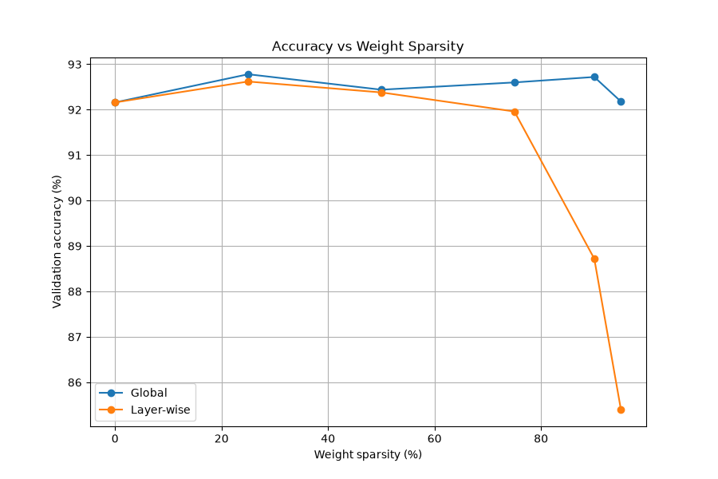
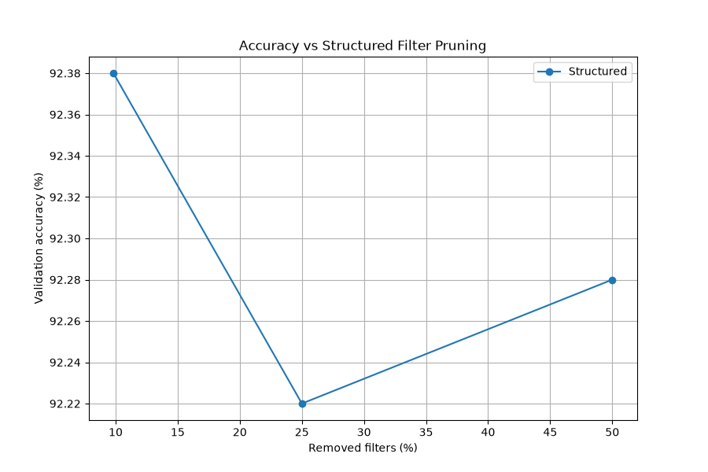

## AI Lab 7
### Karina Romanova 71616
### Group 2

## 1. Introduction

The aim was to study model compression techniques and compare their effects on accuracy, storage size and inference latency. The experiments used Fashion-MNIST and were performed on CPU.
The work included training a baseline CNN, applying magnitude pruning, comparing dense and sparse storage, and training a smaller student model with and without knowledge distillation.

## 2. Experimental Setup

- Dataset: Fashion-MNIST
- Input images: grayscale, 28 × 28 pixels
- Number of classes: 10
- Training/validation split: 55,000 / 5,000 images
- Test set: 10,000 images
- Device: CPU
- Baseline optimizer: Adam
- Baseline learning rate: 0.001
- Baseline training: 10 epochs
- Pruning fine-tuning: 3 epochs
- Student training: 10 epochs

## 3. Baseline CNN

| Metric | Result |
|---|---:|
| Parameters | 896,906 |
| Test accuracy | 92.23% |
| Checkpoint size | 3.43 MB |
| Initial measured CPU latency | 1.758 ms/image |
| Best validation accuracy | 92.16% |

## 4. Magnitude Pruning

### 4.1 Global and Layer-wise Pruning

| Method | Target sparsity | Actual sparsity | Validation accuracy |
|---|---:|---:|---:|
| Global | 25% | 25% | 92.78% |
| Global | 50% | 50% | 92.44% |
| Global | 75% | 75% | 92.60% |
| Global | 90% | 90% | 92.72% |
| Global | 95% | 95% | 92.18% |
| Layer-wise | 25% | 25% | 92.62% |
| Layer-wise | 50% | 50% | 92.38% |
| Layer-wise | 75% | 75% | 91.96% |
| Layer-wise | 90% | 90% | 88.72% |
| Layer-wise | 95% | 95% | 85.40% |

### 4.2 Structured Pruning

| Target filter removal | Actual weight sparsity | Filters removed | Validation accuracy |
|---|---:|---:|---:|
| 10% | 1.03% | 9.82% | 92.38% |
| 25% | 2.58% | 25.00% | 92.22% |
| 50% | 5.16% | 50.00% | 92.28% |

## 5. Storage and Inference Efficiency

| Model | Sparsity | Dense size (MB) | Sparse COO size (MB) | CPU latency (ms/image) |
|---|---:|---:|---:|---:|
| Baseline | 0% | 3.43 | 18.52 | 0.745 |
| Global | 50% | 3.43 | 9.73 | 0.633 |
| Global | 90% | 3.43 | 2.12 | 0.646 |
| Global | 95% | 3.43 | 1.10 | 0.715 |
| Layer-wise | 50% | 3.43 | 9.26 | 0.787 |
| Layer-wise | 90% | 3.43 | 1.86 | 0.621 |
| Layer-wise | 95% | 3.43 | 0.93 | 0.614 |

## 6. Knowledge Distillation

Knowledge distillation was tested using the baseline CNN as the teacher and a smaller CNN as the student.

The student contained 73,658 parameters. It was trained in two ways:

- Plain Student: standard cross-entropy loss.
- Distilled Student: a combination of cross-entropy loss and KL-divergence between the student and teacher output distributions.

The distillation settings were temperature T = 4 and alpha = 0.5:

Loss = alpha * CE + (1 - alpha) * T^2 * KL`

### 6.1 Results

| Model | Parameters | Test accuracy | Size (MB) | CPU latency (ms/image) |
|---|---:|---:|---:|---:|
| Teacher | 896,906 | 92.23% | 3.425 | 0.607 |
| Plain Student | 73,658 | 90.44% | 0.285 | 0.344 |
| Distilled Student | 73,658 | 89.63% | 0.285 | 0.414 |

## 7. Efficiency Analysis

| Pillar | Experiment and observation |
|---|---|
| Data | Fashion-MNIST and the same train/validation/test split were used across the experiments. Data compression and data augmentation were not evaluated. |
| Model | Global and layer-wise pruning reduced the number of non-zero weights. Student models used 73,658 parameters instead of 896,906. |
| Compute | CPU inference latency was measured. Smaller student models were faster than the teacher in the distillation experiment. Unstructured sparsity did not consistently accelerate dense inference. |
| Energy | Energy consumption was not measured directly because no power measurement equipment or energy profiling tool was used. |

## 8. Conclusion

## Conclusion

The experiments showed that pruning can reduce the number of non-zero weights while maintaining good accuracy. The student model was significantly smaller and faster than the teacher. However, knowledge distillation did not improve accuracy in this experiment. Overall, model compression reduces model size, but does not always improve inference speed.